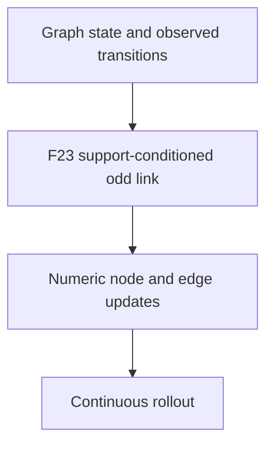

# Architecture

F22 learns continuous six-node graph dynamics; F23 AdaptiveOddLink estimates nonlinear response from 96 observed transitions. Unlike NC3 it predicts numerical updates rather than selecting masks.

## Data and model state

F22 and F23 checkpoints and the frozen upstream F21 package are included.

## Implementation

[original guide](research/TWM_ORION_F22_F23/README_START_HERE_RU.md) · [archived results](research/TWM_ORION_F22_F23/results/SUMMARY.json) · [Model card](docs/MODEL_CARD.md)

`release.json` identifies the native directory and the exact commands executed by the launcher. The source tree contains the implementation, synthetic data or generators, historical protocols and experiment logs.
