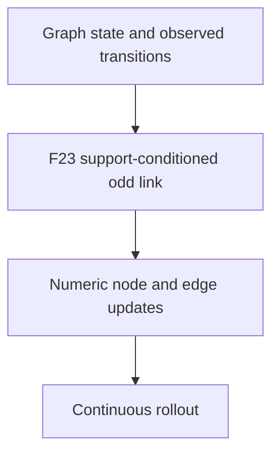

# ORION F22–F23 — Adaptive Causal Dynamics

[Русский](README_RU.md) · [Model card](MODEL_CARD.md) · [Releases](https://github.com/skatzrskx55q/twm-orion-f22-f23/releases/tag/v0.1.0-research)

> Research prerelease · 0.1.0-research · **Accepted task-specific continuous reference baseline**

## Overview

F22 learns continuous six-node graph dynamics; F23 AdaptiveOddLink estimates nonlinear response from 96 observed transitions. Unlike NC3 it predicts numerical updates rather than selecting masks.

This release studies action-conditioned transitions in structured synthetic worlds. It predicts changes to the represented world state from the evidence specified by the native protocol. It can be used for controlled ablations and replication of transition or rollout experiments.

## Architecture



Full implementation and data flow are linked in [ARCHITECTURE.md](ARCHITECTURE.md).

## Historical benchmarks

Results come from the archived synthetic protocol. The [full benchmark record](BENCHMARKS.md) links the underlying artifacts.

| Experiment | Result | Reference |
|---|---:|---|
| New response H90 | 90/96 F23 | 33/96 F22 · 0/96 F21-P2 |
| New topology and response H90 | 69/72 F23 | 32/72 F22 · 0/72 F21-P2 |
| F22 native family H90 | 63/64 F22 | 0/64 comparison |

## Quick start

Linux x86-64 CPU, Python 3.13, and at least 1 GiB working space plus dependency space. [Installation and ZIP instructions](QUICKSTART.md).

```bash
git clone https://github.com/skatzrskx55q/twm-orion-f22-f23.git
cd twm-orion-f22-f23
python3.13 -m venv .venv
. .venv/bin/activate
python -m pip install torch==2.10.0 --index-url https://download.pytorch.org/whl/cpu
python -m pip install -r requirements.txt
python verify_integrity.py
python run.py check
python run.py --keep ../twm-orion-f22-f23-demo demo
```

Runs the broader native reproduction suite with archived weights and synthetic worlds.

## Training and reproduction

The F23 standalone retraining script fixes a new explicit random seed. Use the original protocol for comparison with archived runs.

```bash
python run.py --keep ../twm-orion-f22-f23-training native -- code/retrain.py --seed 1701 --steps 1800
```

[Original guide](research/TWM_ORION_F22_F23/README_START_HERE_RU.md) · [Reproduction guide](docs/REPRODUCTION.md)

## Data and repository layout

F22 and F23 checkpoints and the frozen upstream F21 package are included.

Archived data, source, checkpoints and metrics are inside `research/`. The root launcher copies the native tree before execution. `research_manifest.json` lists original SHA-256 hashes and `validation/` contains archived and release-time checks.

## Validation and limitations

`check` **PASS** · `demo` **PASS**. Selected checks exercise the documented native entry points. [Logs and environment](validation/linux-cpu.md).

Fixed six nodes; no creation/deletion of edges or arbitrary new operations. Earlier controls received the same 96 observations but were not trained with that support budget.

## TWM Research Series

[twm-orion-f24-f25](https://github.com/skatzrskx55q/twm-orion-f24-f25) · [twm-orion-nc4](https://github.com/skatzrskx55q/twm-orion-nc4) · [Series index](SERIES.md)

## License and citation

TWM-owned material uses [MIT](LICENSE). [Licensing and attribution](LICENSE_NOTICE.md) records source notices. Cite the research release with [CITATION.cff](CITATION.cff) and identify the archived benchmark and seed used.
