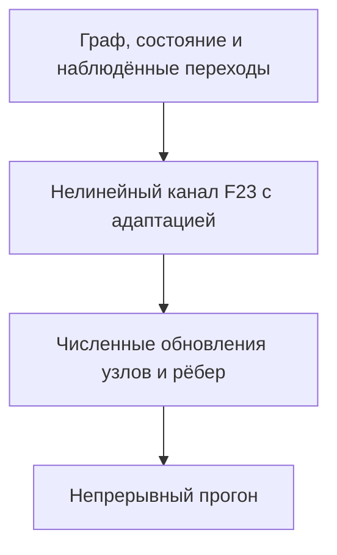

# ORION F22–F23 — Adaptive Causal Dynamics

[English](README.md) · [Карточка модели](docs/MODEL_CARD_RU.md) · [Релиз](https://github.com/skatzrskx55q/twm-orion-f22-f23/releases/tag/v0.1.0-research)

> Исследовательский предварительный релиз · 0.1.0-research · **Принятый специализированный непрерывный baseline**

## Обзор

F22 обучается непрерывной динамике графа с шестью узлами; F23 AdaptiveOddLink оценивает нелинейный отклик по 96 наблюдаемым переходам. В отличие от NC3 прогнозирует численные изменения, а не маски.

В релизе исследуются переходы под действием команд в структурированных синтетических мирах. Модель предсказывает изменение состояния по наблюдениям, заданным исходным протоколом. Пакет предназначен для контролируемых абляций и повторения экспериментов с переходами или траекториями.

## Архитектура



Исходный код и схема работы описаны в [ARCHITECTURE.md](ARCHITECTURE.md).

## Исторические результаты

Показатели взяты из исторического синтетического эксперимента. [Описание результатов](BENCHMARKS.md) содержит ссылки на исходные материалы.

| Эксперимент | Результат | Контроль |
|---|---:|---|
| H90, новый отклик | 90/96 F23 | 33/96 F22 · 0/96 F21-P2 |
| H90, новые топология и отклик | 69/72 F23 | 32/72 F22 · 0/72 F21-P2 |
| H90, исходное семейство F22 | 63/64 F22 | 0/64 comparison |

## Быстрый старт

Linux x86-64 CPU, Python 3.13 и от 1 GiB рабочего места на диске плюс место для зависимостей. [Установка и запуск из ZIP](QUICKSTART.md).

```bash
git clone https://github.com/skatzrskx55q/twm-orion-f22-f23.git
cd twm-orion-f22-f23
python3.13 -m venv .venv
. .venv/bin/activate
python -m pip install torch==2.10.0 --index-url https://download.pytorch.org/whl/cpu
python -m pip install -r requirements.txt
python verify_integrity.py
python run.py check
python run.py --keep ../twm-orion-f22-f23-demo demo
```

Запускает расширенный исходный набор проверок с архивными весами и синтетическими мирами.

## Обучение и воспроизведение

Скрипт переобучения F23 фиксирует новый явный seed. С архивными запусками сравнивайте по исходному протоколу.

```bash
python run.py --keep ../twm-orion-f22-f23-training native -- code/retrain.py --seed 1701 --steps 1800
```

[Исходное руководство](research/TWM_ORION_F22_F23/README_START_HERE_RU.md) · [Инструкция по воспроизведению](docs/REPRODUCTION_RU.md)

## Данные и структура репозитория

Включены веса F22 и F23, а также исходный пакет F21.

Исторические данные, код, веса и метрики лежат в `research/`. Перед запуском обёртка создаёт отдельную копию исходного дерева. В `research_manifest.json` записаны исходные SHA-256. В `validation/` хранятся архивные и новые проверки.

## Проверки и ограничения

`check` **PASS** · `demo` **PASS**. Выборочные проверки охватывают указанные исходные команды. [Журналы и окружение](validation/linux-cpu.md).

Фиксированные шесть узлов; нет создания/удаления рёбер и произвольных новых операций. Контроли получили те же 96 наблюдений, но ранее не обучались на таком бюджете.

## TWM Research Series

[twm-orion-f24-f25](https://github.com/skatzrskx55q/twm-orion-f24-f25) · [twm-orion-nc4](https://github.com/skatzrskx55q/twm-orion-nc4) · [Каталог серии](SERIES.md)

## Лицензия и цитирование

Материалы TWM выпущены под [MIT](LICENSE). Исходное авторство указано в [лицензионных уведомлениях](LICENSE_NOTICE.md). Для цитирования релиза используйте [CITATION.cff](CITATION.cff) и указывайте исходный эксперимент и seed.
